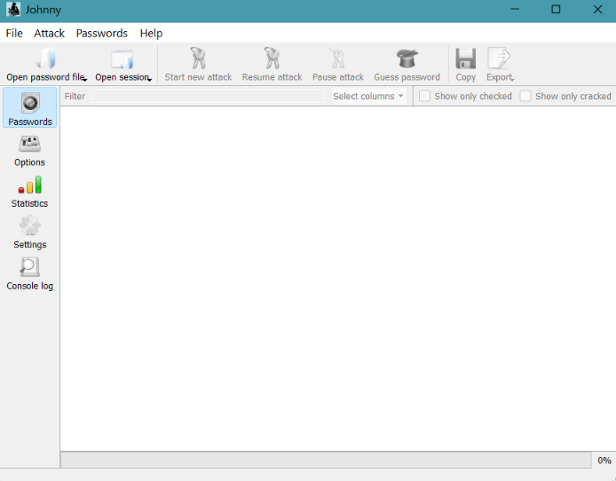
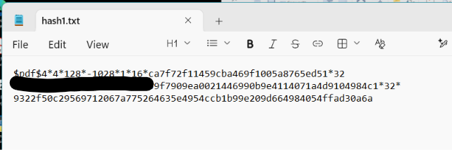
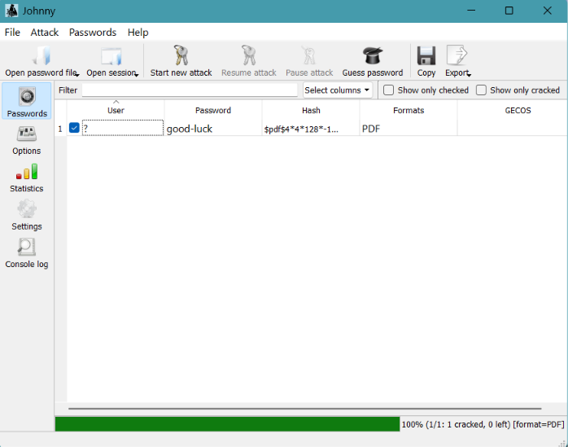
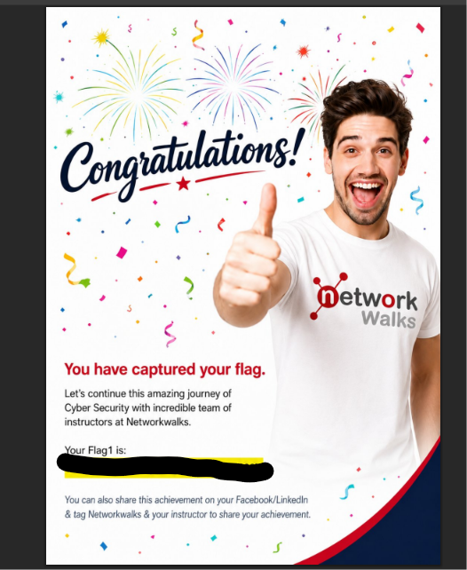
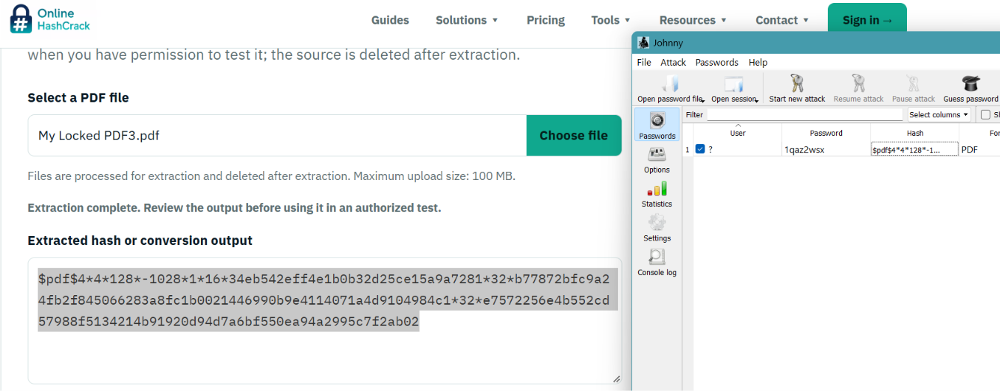
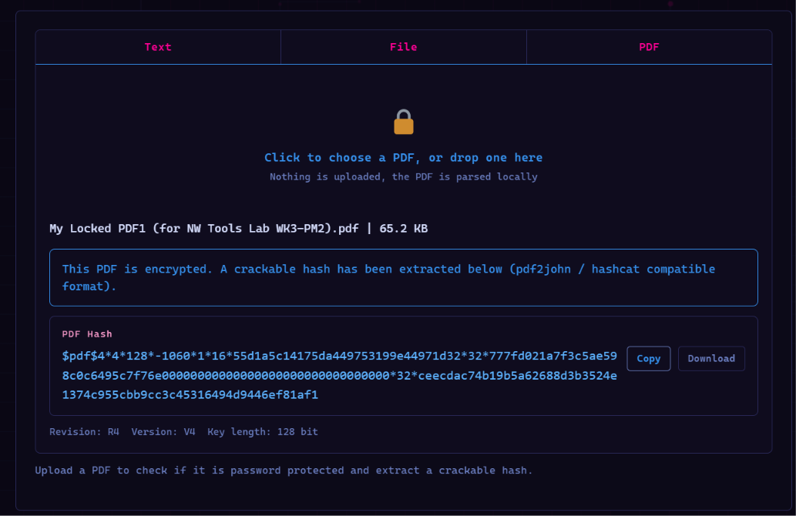
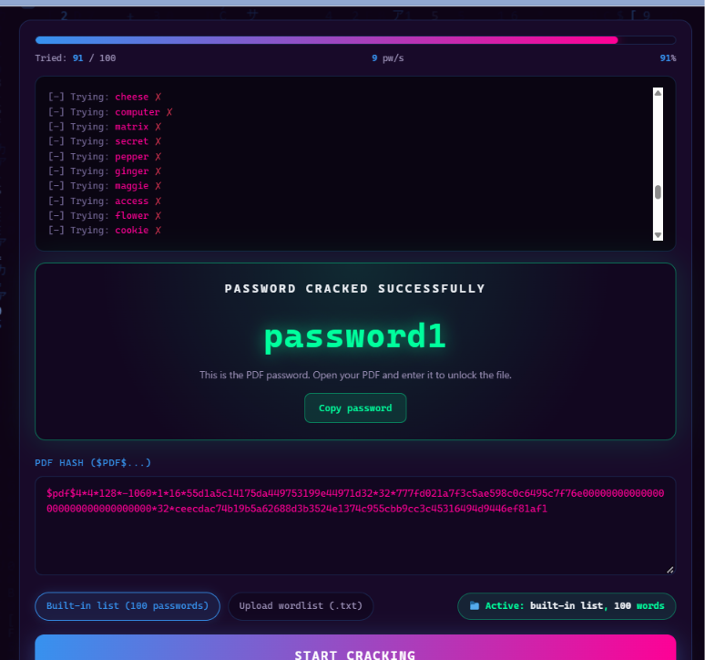
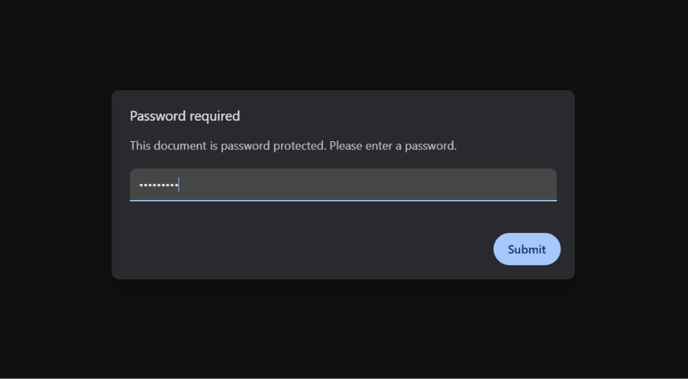
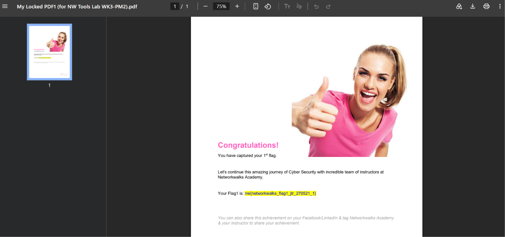

# NETWORKWALKS-B084-WK3-PASSWORD-CRACKING-LABS
# 🔐 Password Cracking Labs — John the Ripper (JTR) & NetworkWalks Tools

**Week 3 | NetworkWalks Cybersecurity & Ethical Hacking Internship**

How easy is it to unlock a password-protected PDF without knowing its password? That's exactly what I explored in this week's hands-on cybersecurity labs! 🚀

I worked on two separate password-cracking tasks, each involving a different encrypted PDF file and a different set of tools.

- **Lab 1:** John the Ripper (JTR) with Johnny GUI.
- **Lab 2:** NetworkWalks' browser-based Hash Calculator and Password Cracker.

The objective was to extract the hash from each PDF, perform a wordlist-based attack, recover its password, and verify that the file could be unlocked.

## 🧠 Understanding the Basics

Before getting into the practical, here's what happens behind the scenes:

- **Hashing:** A one-way process that converts data into a hash. The original password isn't directly stored in the hash.
- **Encryption:** Protects data so it can only be accessed using the correct password or key.
- **Password Cracking:** Attempts different password combinations until a matching password is found.

The general workflow was:

**Extract the hash → Run an attack → Recover the password → Verify access.**

---

## 🛠️ Module 1 — Password Cracking with John the Ripper (JTR) + Johnny GUI

For the first lab, I used **John the Ripper**, a popular password-cracking tool, along with Johnny, its graphical user interface.

### ⚙️ What I Did

1. Downloaded and extracted John the Ripper and Johnny on Windows.
2. Used [Online Hash Crack's PDF Hash Extractor](https://www.onlinehashcrack.com/tools-pdf-hash-extractor.php) to extract the hash from the first protected PDF.
3. Saved the extracted `$pdf$...` hash into `hash1.txt`.
4. Launched Johnny and configured it to use the `john.exe` executable.
5. Loaded `hash1.txt` as the password file.
6. Started a new attack and allowed JTR to test passwords against the extracted hash.
7. **Successfully recovered the password: `password1`.** 🎉
8. Entered the recovered password and verified that the first PDF opened successfully.

### 📸 Practical Screenshots

| Step | Screenshot |
|---|---|
| Selecting `john.exe` executable |  |
| Johnny GUI interface |  |
| Extracted hash saved to text file |  |
| Password successfully recovered |  |
| PDF unlocked successfully |  |
| File 3 password cracked |  |

---

## 🛠️ Module 2 — Password Cracking Using NetworkWalks Tools

For the second lab, I worked with a **different password-protected PDF** and explored NetworkWalks' browser-based tools.

This approach allowed me to perform hash extraction and password cracking directly through the browser.

### ⚙️ What I Did

1. Opened the [NetworkWalks Hash Calculator](https://networkwalks.com/hash-calculator/).
2. Selected the second protected PDF and extracted its `$pdf$...` hash.
3. Copied the complete extracted hash.
4. Opened the [NetworkWalks Password Cracker](https://networkwalks.com/password-cracker/).
5. Pasted the hash and launched the built-in wordlist attack, which tested 100 passwords.
6. **Successfully recovered the password: `[SECOND PASSWORD]`.** 🔓
7. Entered the recovered password to verify that the second PDF opened successfully.

### 📸 Practical Screenshots

| Step | Screenshot |
|---|---|
| Hash extracted via NetworkWalks Hash Calculator |  |
| Password Cracker attack in progress |  |
| Successful password recovery |  |
| Password cracked confirmation screen |  |
| PDF opened with recovered password |  |

---

## 🔍 Key Learnings

Working with two different PDFs and two different approaches helped me understand the practical workflow of password recovery.

Some important takeaways:

- Learned how password hashes can be extracted from protected PDF files.
- Gained hands-on exposure to John the Ripper and its Johnny GUI.
- Explored browser-based hash extraction and password-cracking tools.
- Understood how dictionary and wordlist attacks work.
- Observed how weak or predictable passwords can be vulnerable to cracking attempts.

### 💡 The Biggest Takeaway

Password security is not just about setting a password — it's about choosing one that is difficult to predict or guess.

This exercise reinforced the importance of using long, unique, and unpredictable passwords instead of common words or easily guessed combinations.

**Two different PDFs. Two different tools. Two successful password recoveries!** 🔐

*Part of the Cybersecurity & Ethical Hacking Internship — NetworkWalks | Week 3*
